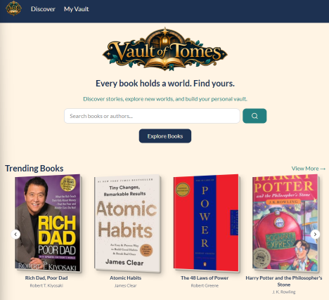
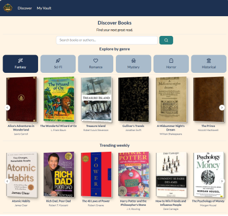
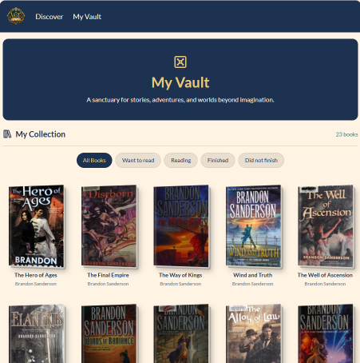
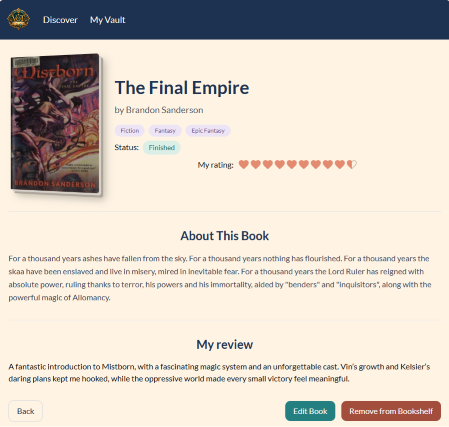

# The Vault of Tomes 📚

A fantasy-inspired book discovery and reading tracker built with React. Explore books using Open Library, save favourites to a personal vault, track reading progress, and record ratings and reviews.

## Features

-   **Discover books:** Search for titles and browse trending books using the Open Library API.
-   **Explore book details:** View book covers, authors, descriptions, and genres when available.
-   **My Vault:** Save books to a personal collection and browse your saved titles.
-   **Reading statuses:** Organise books as _Want to read_, _Reading_, _Finished_, or _Did not finish_.
-   **Manage your collection:** Add, view, edit, and remove saved book records.
-   **Ratings and reviews:** Record your thoughts on books you've read.
-   **Responsive interface:** A mobile-first design with a fantasy-inspired colour palette and book-cover styling.

## Tech Stack

-   **Frontend:** React, Vite, JavaScript, React Router
-   **Styling and UI:** Tailwind CSS, shadcn/ui Carousel, Lucide React, MUI Rating
-   **HTTP requests:** Axios
-   **External API:** [Open Library](https://openlibrary.org/developers/api)
-   **Backend:** JSON Server, deployed on Render
-   **Frontend hosting:** Vercel

## How It Works

The app uses the **Open Library API** to find books and display public book information. Your saved collection and reviews are stored separately in a **JSON Server** backend. Saved books use Open Library work IDs to associate records with their source titles.

## Getting Started

### Prerequisites

-   Node.js and npm
-   Access to the project's JSON Server backend (or a locally running equivalent)

### Installation

1.  Clone this repository:
    
    ```
    git clone https://github.com/dwrossouw/module-2-project.git
    cd module-2-project
    ```
    
2.  Install dependencies:
    
    ```
    npm install
    ```
    
3.  Create a `.env` file in the project root and configure both API URLs:
    
    ```
    VITE_JSON_SERVER_URL=https://module2-project-json-server-21pu.onrender.com
    VITE_OPEN_LIBRARY_URL=https://openlibrary.org
    ```
    
4.  Start the development server:
    
    ```
    npm run dev
    ```
    
5.  Open the local URL printed by Vite in your terminal.
    

`VITE_JSON_SERVER_URL` points to the Render-hosted JSON Server used for saved books and reviews. `VITE_OPEN_LIBRARY_URL` points to Open Library for book discovery and metadata. Restart the Vite server after changing `.env`.

> **Note:** If the Render backend is on a free instance, the first request after a period of inactivity may take longer while the service wakes up.

## Project Structure

The application includes pages for Home, Discover, individual book details, My Vault, adding and editing saved books, and About. It also uses reusable components and API requests to keep the interface organised.

```text
module-2-project/
├── src/
│   ├── assets/          # Images and branding
│   ├── components/      # Reusable UI components
│   │   └── ui/          # shadcn/ui components
│   ├── data/            # Filters and genres
│   ├── hooks/           # Custom React hooks
│   ├── lib/             # Shared utilities
│   ├── pages/           # Application views
│   ├── services/        # API requests
│   ├── utils/           # Helper functions
│   ├── App.jsx          # Main app and routing
│   └── main.jsx         # Entry point
├── screenshots/         # Application screenshots
├── package.json         # Dependencies and scripts
├── vite.config.js       # Vite configuration
└── README.md            # Documentation
```


## Ironhack Module 2 Requirements and Delivery

This project was developed for Ironhack's second project: a multi-view React single-page application integrated with an API, supporting full CRUD functionality and deployed online. 

**1. React SPA with multiple views**

Built with React and React Router. Views include Home, Discover, book details, My Vault, and pages for adding or editing books.

**2. API integration with full CRUD**

Open Library provides discovery data. A separate JSON Server backend stores books and reviews. The vault supports **Create** (save a book), **Read** (view saved books/details), **Update** (edit a saved book or reading status), and **Delete** (remove a saved book).


## AI Usage and Development Process

ChatGPT was used as a **learning and development assistant** throughout the project. Its role included:

-   Explaining React, JavaScript, API calls, asynchronous operations, and routing concepts when I needed clarification.
-   Providing hints and debugging guidance to help me identify and resolve implementation issues, rather than automatically writing every solution.
-   Discussing component organisation, responsive layouts, Tailwind CSS utilities, colour choices, and user-experience decisions.
-   Helping troubleshoot external API connectivity, missing cover images, backend data issues, and deployment-related configuration.
-   Assisting with the preparation of sample book data and generating positive example reviews and ratings for finished books in the JSON Server seed data. **These generated reviews are demonstration content, not independently written reader testimonials.**
-   Helping draft and organise this README.

I used AI suggestions as input to my own development process, reviewed and adapted them, and made decisions about the application's features, design, and implementation. The project also involved independent coding, testing, and troubleshooting.

## Challenges and Learning

This project was an opportunity to practise:

-   Working with an external API and a separate CRUD backend
-   Handling asynchronous requests, loading states, and API errors
-   Building dynamic routes and navigating between book details and saved records
-   Managing component state and forms in React
-   Designing responsive layouts and reusable UI components
-   Handling missing book-cover images and inconsistent external data

## Screenshots

### Homepage



### Discover Books


### My Vault

### Book Details Page

### Edit Book Page


## Live Demo and Repository

-   **Live app (Vercel):** [https://vault-of-tomes.vercel.app/](https://vault-of-tomes.vercel.app/)
-   **Frontend GitHub repository:** [https://github.com/dwrossouw/module-2-project](https://github.com/dwrossouw/module-2-project)
-   **Backend GitHub repository:** [https://github.com/dwrossouw/module2-project-json-server](https://github.com/dwrossouw/module2-project-json-server)
-   **JSON Server backend (Render):** [https://module2-project-json-server-21pu.onrender.com/](https://module2-project-json-server-21pu.onrender.com/)

## Future Improvements

-   Additional discovery and recommendation features
-   Further accessibility and usability refinements

## Author

Created as a web development project for the Ironhack bootcamp.
